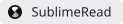

 

I build the whole stack: the screen, the API, and the data underneath. React and Next.js on the front, Rails and PostgreSQL behind it. Lately going deeper into infrastructure and AWS.

On the side I build , ,  and .
