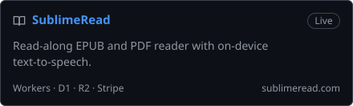
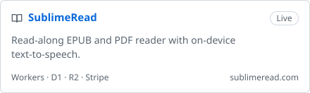
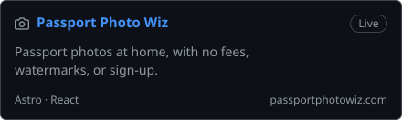
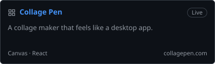
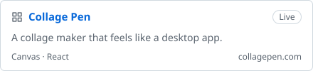
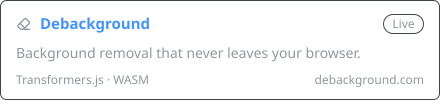
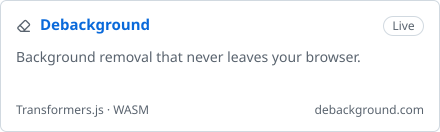

# Hi, I'm Sujeet 👋

Senior Full-Stack Engineer at [Event Temple](https://www.eventtemple.com) · Metro Vancouver, BC 
[kcsujeet.com.np](https://kcsujeet.com.np) · [Blog](https://kcsujeet.com.np/blog) · [LinkedIn](https://www.linkedin.com/in/kc-sujeet)

I build the whole stack: the screen, the API, and the data underneath. React and Next.js on the front, Rails and PostgreSQL behind it. Lately going deeper into infrastructure and AWS.

### Side projects

 

 
